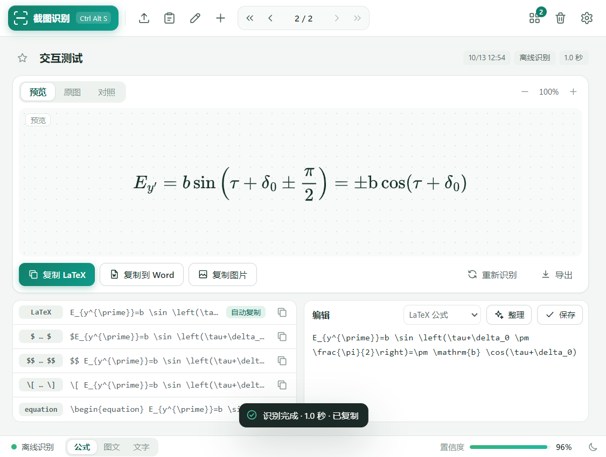
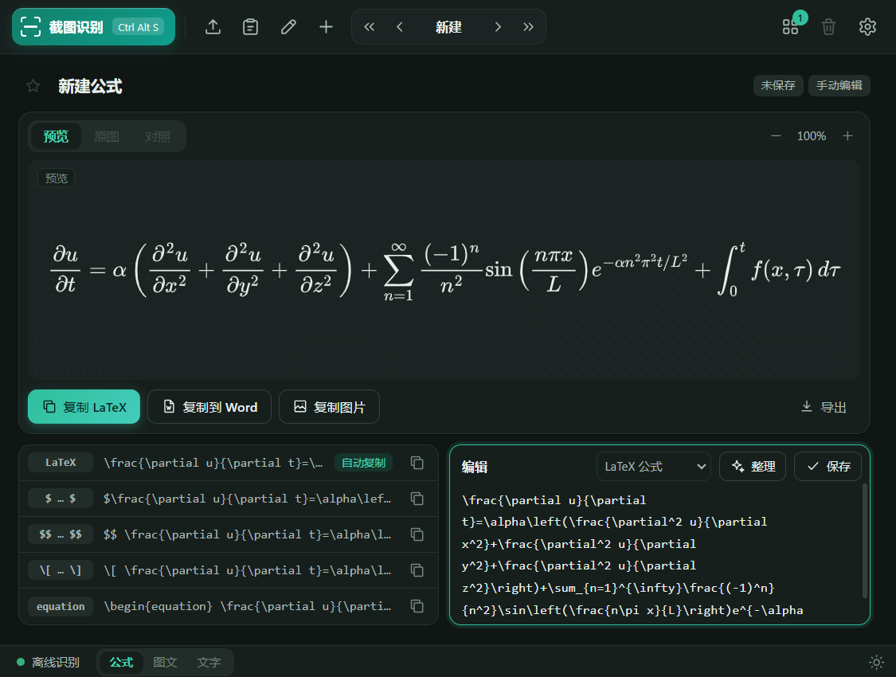
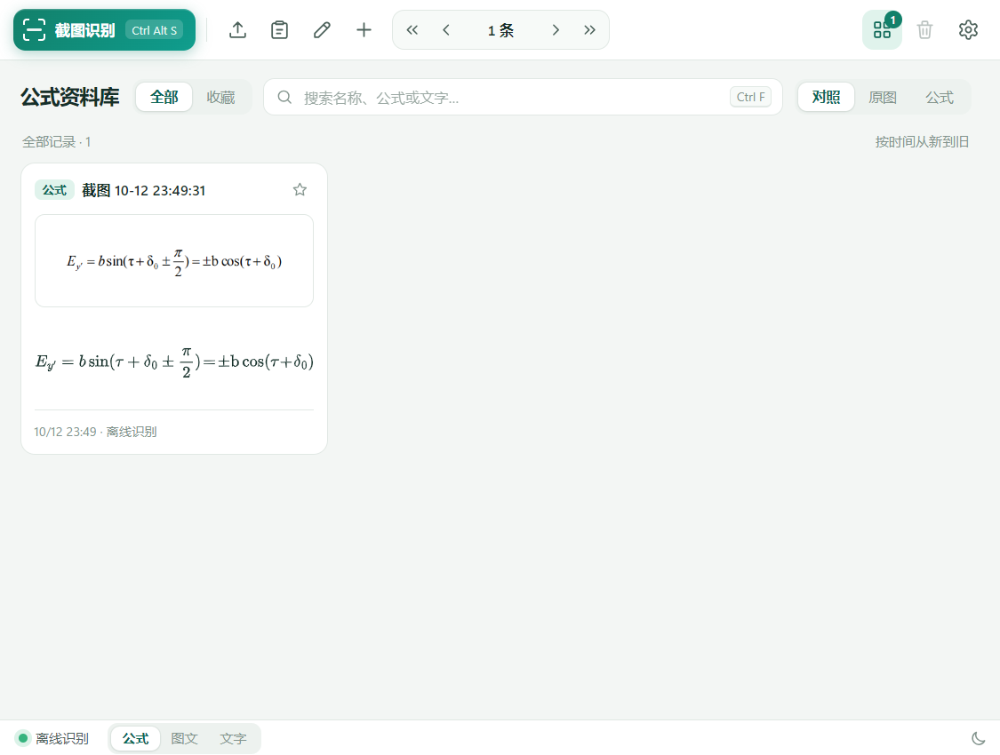
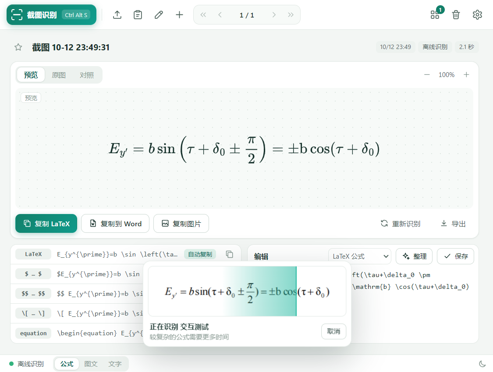

# 拾式 FormulaSnip

Windows 上的离线公式截图识别工具。框选公式，得到可编辑的 LaTeX，并复制到笔记或导出为 Word 公式。

**当前版本：1.1.0 · Windows x64 · 离线优先 · 中文界面**

[下载 Windows 便携版](https://github.com/cuisonku-glitch/FormulaSnip/releases/latest) · [使用说明](docs/使用说明.txt) · [版本记录](CHANGELOG.md) · [构建说明](docs/BUILD.md)



## 快速开始

1. 在 [Releases](https://github.com/cuisonku-glitch/FormulaSnip/releases) 下载 `FormulaSnip-1.1.0.exe`，放到固定、可写的文件夹中运行。
2. 按 **Ctrl + Alt + S**，拖动框选屏幕中的公式。
3. 核对识别结果；点击格式行即可复制，也可以编辑 LaTeX 后保存。
4. 需要 Word 可编辑公式时，选择导出 **DOCX**。

便携版已包含离线模型和运行库，无需另外安装 Python、LaTeX、Office 或显卡驱动扩展。单文件启动需要解压运行库，首次打开请稍候。

## 功能

| 功能 | 支持内容 |
| --- | --- |
| 输入 | 全局截图快捷键、图片导入、剪贴板粘贴、拖放、手写板、PDF 选页 |
| 离线识别 | 数学公式 → LaTeX；中英文文字；图文混排 → 带公式的 Markdown |
| 编辑与预览 | 实时预览、原图对照、缩放、LaTeX 整理、浅色与深色主题 |
| 复制 | LaTeX、行内与独立公式、equation 环境、MathML、公式图片 |
| 导出 | DOCX 可编辑公式、PNG、SVG、LaTeX、Markdown、MathML、原图 |
| 资料库 | 本地保存、搜索、收藏、翻页、删除、ZIP 备份 |
| 联网接口 | 可选 Mathpix OCR API 或兼容 Chat Completions 的视觉接口，自备密钥 |

### 1.1.0 的变化

- 紧凑顶部工具栏，默认窗口为 900 × 680；支持深色模式并记住窗口大小与位置。
- 自动整理离线识别结果的 LaTeX，移除多余间距、整理上下标，并为包含分式的成对括号补充伸缩标记。
- 后台预热公式模型，减少首次识别的加载等待。
- 支持选择自动复制格式；格式整行、资料库卡片均可直接复制。
- 导出与复制图片前自动保存修改；增加记录导航和常用快捷键。

整理功能不会纠正识别错误；旧记录需要手动点“整理”后保存。[完整更新记录](CHANGELOG.md)

<details>
<summary>更多界面预览</summary>

### 深色模式



### 资料库



### 识别进度



</details>

## 数据与升级

默认离线识别，图片与历史记录保存在本机。只有主动选择联网引擎后，识别图片才会发送到配置的服务；离线失败不会自动上传。

数据默认位于 exe 旁的 `FormulaSnipData/`。该目录不可写时，使用 `%LOCALAPPDATA%\FormulaSnip`。升级前保存修改，在系统托盘菜单选择“退出”，然后运行同目录的新版本，保留原有数据文件夹。

联网密钥使用 Windows DPAPI 加密。迁移到其他 Windows 用户或电脑后需重新填写。

## 从源码运行

需要 **Windows x64、Python 3.12**。在仓库根目录执行：

```powershell
py -3.12 -m venv .venv
.\.venv\Scripts\python.exe -m pip install -r FormulaSnip\requirements-lock.txt
.\.venv\Scripts\python.exe download_assets.py
.\.venv\Scripts\python.exe FormulaSnip\main.py
```

模型权重通过 `download_assets.py` 从官方来源下载，并与仓库内的 SHA-256 清单核对。权重不放入 Git；Release 的 exe 已包含模型。

打包、依赖替换和测试步骤见 [docs/BUILD.md](docs/BUILD.md)。

## 已知限制

- 离线模型的准确率不等同于 Mathpix；手写、模糊图片、长公式和复杂排版需要人工核对。
- 图文混排尽力合并阅读顺序，不恢复复杂表格或整页的原始版式。
- PDF 通过选页渲染后 OCR，不能完整复刻 PDF 到 Word 的版式。
- 模型评分不是经过校准的正确率；一条公式最多生成 768 个 token。
- 某些 LaTeX 宏可预览，但 Word 转换器不支持，可以改写或使用 PNG/SVG。
- 无账号、云同步或 Mathpix 订阅服务。发布程序暂未做数字签名。

## 项目结构

```text
FormulaSnip/          应用、界面、模型清单、第三方许可、打包配置
docs/                使用、构建、验证说明及界面截图
download_assets.py   下载并校验离线模型与 MathJax
validate_core.py     核心逻辑回归测试
build.ps1            Windows 构建入口
```

## 许可与致谢

原创代码采用 [MIT License](LICENSE)。第三方组件保留各自许可，见 [许可文件](FormulaSnip/licenses/)；Qt / PySide6 使用 LGPLv3 组件，源码和构建流程支持替换依赖后重新打包。

- [Pix2Text](https://github.com/breezedeus/Pix2Text)：MFR 1.5 公式识别与 MFD 1.5 公式定位模型。
- [RapidOCR](https://github.com/RapidAI/RapidOCR)：中英文文字识别。
- [MathJax](https://github.com/mathjax/MathJax)：本地公式预览。
- [ONNX Runtime](https://github.com/microsoft/onnxruntime)、[Qt for Python](https://doc.qt.io/qtforpython-6/)：推理与桌面界面。

本项目独立开发，与 Mathpix 无隶属关系，不包含其专有模型或账号服务。
